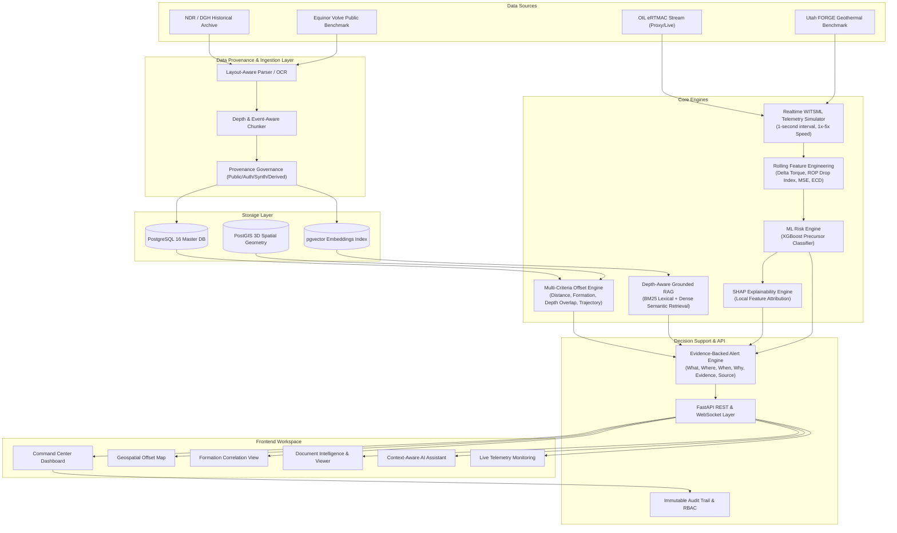

# eRTMAC–NWIS Architecture & Technical Specification

## 1. System Context & Architecture Diagram

## 2. Multi-Criteria Offset Relevance Scoring

Rather than relying solely on surface Euclidean distance, NWIS computes a progressive composite relevance score:

$$\text{Relevance Score} = 0.25 \cdot S_{\text{dist}} + 0.25 \cdot S_{\text{formation}} + 0.20 \cdot S_{\text{depth}} + 0.15 \cdot S_{\text{trajectory}} + 0.15 \cdot S_{\text{event}}$$

Where:
- $S_{\text{dist}}$: Exponential spatial decay over the configured search radius ($15 \text{ km}$).
- $S_{\text{formation}}$: Exact lithological match in target formation (e.g. Tipam Sandstone = 1.0).
- $S_{\text{depth}}$: Overlap in exploration depth window ($|MD_{\text{active}} \pm 300\text{m}| \cap |0, TD_{\text{offset}}|$).
- $S_{\text{trajectory}}$: 3D wellbore lateral divergence calculated via directional survey inclination and azimuth.
- $S_{\text{event}}$: Verified historical operational events (stuck pipe, mud loss, kick) recorded in the same formation.

## 3. Real-Time Streaming Architecture

### MVP:
- Native WebSocket connection (`/ws/live-well/{well_id}`) delivering structured JSON packets at 1 Hz.
- Normalizes incoming measurements once in Zustand state to prevent whole-dashboard re-renders.

### Future Enterprise Integration:
- Apache Kafka topic: `ertmac.rig.witsml.v1`
- MQTT edge broker deployed at wellsite rig cabins.
- WITSML 1.4.1 / 2.0 XML schema translation microservice.
